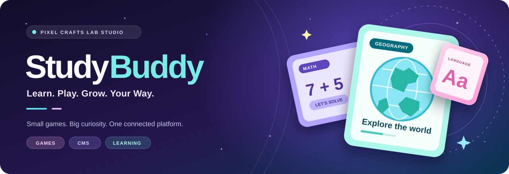
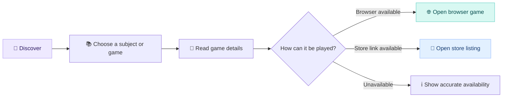
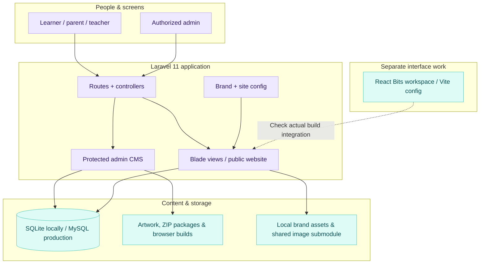
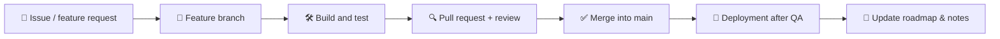

<p align="center">
  
</p>

<h1 align="center">StudyBuddy</h1>
<p align="center"><strong>Learn. Play. Grow. Your Way.</strong></p>
<p align="center">A growing universe of small learning games, a public discovery website, and the admin CMS that brings them together.</p>

<p align="center">
  <a href="https://studybuddy.fun/"></a>
  <a href="https://github.com/MehAk-ArmAn/StudyBuddy"></a>
  <a href="https://github.com/MehAk-ArmAn/StudyBuddy/blob/main/FEATURE_ROADMAP.md"></a>
</p>

<p align="center">
  
  
  
  
  
  
</p>

> [!NOTE]
> **Read this first:** This README is the developer entry point for the shared repository. It distinguishes **existing documented behavior** from **proposed roadmap features**. It is not a claim that every planned feature is already live or that the current production release has passed fresh QA. The repository is a collaborative codebase: the current user-selected workflow is reviewed, guarded changes directly on `main` (coordinate simultaneous contributors).

---

<!-- STUDYBUDDY_2026_MASTER_PLAN_BEGIN -->
## 💜 StudyBuddy product blueprint — 18 November 2026 (current planning pointer)

**Canonical project plans:** [Product Master](docs/STUDYBUDDY_MASTER_PLAN.md) · [All React Blocks & Placement](docs/REACT_COMPONENT_PLACEMENT_MATRIX.md) · [Delivery Phases](docs/PHASES_AND_RELEASE_GATES.md) · [Role & Child Safety](docs/ROLE_PERMISSIONS_AND_SAFEGUARDING.md) · [Source Map](docs/SOURCE_CODE_MAP.md) · [AI/Team Handoff](docs/AGENT_CONTEXT_AND_HANDOFF.md).

**Real reported status:** Packs 05–09 passed Mac PHPUnit and were pushed to `main`; Pack 10 Resource Studio passed locally (252 tests / 3,689 assertions), **Git push not confirmed**. These results do **not** verify production release. **Upcoming:** P11 Head Admin + school RBAC, P12 monitoring, P13 communications and beyond. Requested React Bits Pro screens are planned references, not licensed installs.

**Current delivery convention:** guarded, reviewed, source-backed changes directly to `main` as requested. Historical references later in this README to branch/PR workflows are older guidance and should not be mistaken for the current user-selected convention. Never force push; coordinate simultaneous work.
<!-- STUDYBUDDY_2026_MASTER_PLAN_END -->

## 🧭 Jump to

[Overview](#-what-is-studybuddy) · [Experience](#-the-experience) · [Architecture](#-system-at-a-glance) · [Structure](#-repository-map) · [Stack & tools](#-technology-and-team-toolkit) · [Run locally](#-run-studybuddy-locally) · [Admin CMS](#-admin-and-content-workflow) · [Roadmap](#-feature-roadmap) · [Contributing](#-working-together-one-repo) · [QA](#-testing-and-quality) · [Deployment](#-deployment-notes) · [Security](#-privacy-security-and-trust) · [Docs](#-documentation-directory)

## ✨ What is StudyBuddy?

**StudyBuddy** connects educational games with a consistent way to discover, manage, and launch them. A learner browses the public website, chooses a game, and opens the appropriate browser or app-store experience. Administrators maintain app listings, content, brand settings, and pages from a protected CMS.

| 🎒 For learners | 👪 For families and educators | 🛠️ For the team |
| :-- | :-- | :-- |
| Explore short, playful learning experiences. | Find activities by real learning goals and subject areas. | Manage a reusable platform rather than hard-code each new game. |
| Discover games through their descriptions and categories. | Use parent/teacher-facing information pages. | Publish, preview, update, or unpublish game entries. |
| Open supported browser games or app-store listings. | See age-appropriate, truthful learning information. | Build a consistent visual and content system. |

**Project home:** [studybuddy.fun](https://studybuddy.fun/)  
**Source:** [MehAk-ArmAn/StudyBuddy](https://github.com/MehAk-ArmAn/StudyBuddy)  
**Brand line:** *Learn. Play. Grow. Your Way.*

### What is already documented vs. what's proposed?

| Area | State | Notes |
| :-- | :-- | :-- |
| Public site and game discovery routes | **Documented in current repo** | `/`, `/apps`, `/apps/{slug}`, `/play/{slug}` |
| Protected admin and content-management routes | **Documented in current repo** | App CMS, homepage CMS, pages, shell, settings, users and messages |
| Browser-game package upload / external launch URL | **Documented workflow** | Test before publishing; web packages are stored server-side |
| Laravel / Blade web app | **Current main application** | Standard Composer + Artisan local setup |
| React Bits / Vite workspace | **Present in repo; verify integration** | `studybuddy-reactbits/` and `vite.studybuddy-react.config.mjs` |
| 28-category educational taxonomy | **Defined content standard** | Rollout/coverage requires verification; don't show empty categories |
| Student accounts, learning dashboards, progress histories | **Implemented in locally tested phases** | Verify current route/data behavior and production readiness per new docs |
| Parent / teacher experience expansion | **Role dashboards locally tested** | School-wide production release still requires tenant/safeguarding QA |

---

## 🎮 The experience



### Learning catalogue principles

- **Subject-first, not gimmick-first.** Give each game **one primary academic category**, with optional secondary tags for topics, stages and skills.
- **28 defined academic / enrichment categories** exist in the StudyBuddy content guide. Only publicly surface categories with genuine matching content.
- Be accurate about content: a flag game belongs under Geography; typing exercises under Digital Literacy; number operations under Mathematics.
- A game's artwork, description, age/stage guidance, playable status and links must reflect its real functionality.
- Avoid unverified educational, curriculum-accreditation or child-development claims.

Representative subjects: **Mathematics · English · Science · Geography · Digital Literacy · Visual Arts · Critical Thinking · Study Skills**. These examples do **not** imply all of them already have published games.

---

## 🏗️ System at a glance



**Architecture note:** The public site's current documented baseline is **Laravel 11 + Blade**, and it can be started without a frontend JavaScript build. The repository **also contains** a React Bits-related directory and a dedicated Vite config. Don't assume every Blade route uses React or that the React workspace is automatically built in production; inspect the relevant files and scripts before changing that pipeline.

### How the parts connect

| Responsibility | Where it lives | Why it matters |
| :-- | :-- | :-- |
| HTTP entry points | `routes/`, `public/` | Public pages, game launches and admin endpoints |
| Application logic | `app/` | Controllers and the server-side behaviors behind features |
| Site views / UI | `resources/` | Templates and frontend assets |
| Database schema and seed data | `database/` | Reproducible local environments and migrations |
| Product/brand configuration | `config/` | Including `config/studybuddy.php` |
| Admin-uploaded files | `storage/` | Keep writable, private and backed up |
| Public static assets | `public/` | Including local identity assets |
| UI experimentation / React components | `studybuddy-reactbits/`, `vite.studybuddy-react.config.mjs` | Separate workflow; verify its build/deployment linkage |
| QA and development utilities | `tests/`, `tools/`, `studybuddy_repo_audit_toolkit/` | Test and audit work before changes are merged |

---

## 🗂️ Repository map

The tree below reflects **top-level paths visible in the shared GitHub repository on 17 November 2026**, not a claim about every nested file. Keep the existing directories and history intact.

```text
StudyBuddy/
│
├── .claude/                         # Agent / assistant configuration
├── app/                             # Laravel application code
├── bin/                             # Repository scripts / executables
├── bootstrap/                       # Laravel bootstrap
├── config/                          # Framework and StudyBuddy configuration
├── database/                        # Migrations, seeders, local SQLite DB
├── docs/                            # Documentation and QA notes
│   └── assets/                      # README visuals (add from this package)
│       └── studybuddy-readme-banner.svg
├── public/                          # Public web root and bundled static assets
├── resources/                       # Blade views, styles and client assets
├── routes/                          # Public and admin route definitions
├── storage/                         # Logs, uploads, browser game builds
├── studybuddy-reactbits/            # React Bits-related interface workspace
├── studybuddy_repo_audit_toolkit/   # Repository-audit utilities
├── tests/                           # Automated tests
├── tools/                           # Additional project tools
│
├── .env.example                     # Environment example (safe to commit)
├── .gitignore
├── .gitmodules                      # Shared image-library submodule definition
├── CLAUDE.md                        # Existing project development instructions
├── FEATURE_ROADMAP.md               # Team planning checklist (already in root)
├── README.md                        # THIS FILE — team entry point
├── STUDYBUDDY_V5_README.md         # Legacy project notes (see actual filename)
├── STUDYBUDDY_V6_README.md         # Legacy project notes (see actual filename)
├── artisan                          # Laravel CLI
├── composer.json                    # PHP dependencies
├── composer.lock                     # PHP dependency lockfile
├── package.json                     # JavaScript workspace metadata
├── phpunit.xml                      # PHPUnit test configuration
└── vite.studybuddy-react.config.mjs # React/Vite-specific build config
```

> **Additional existing files:** `NEXT_STEP_README.txt`, `PATCH_README.txt`, `STUDYBUDDY_V7_README.txt`, `UNIVERSE_V4_INSTALL_NOTES.md`, `.cursorignore`. The project also has historical instructions; use **current source code and agreed decisions** over old patch notes when they conflict.

**Important:** `public/assets/studybuddy-brand/` stores local visual identity assets. The existing repo README documents the `public/assets/studybuddy-imgs/` shared image library as a Git submodule. Do not replace either with generic downloaded images or delete the submodule on a routine merge.

---

## 🧰 Technology and team toolkit

| Tool / technology | Role | Required for a basic local run? |
| :-- | :-- | :--: |
| **PHP 8.2+** | Laravel 11 runtime | ✅ |
| **Laravel 11** | Web framework, routing, authentication and CMS logic | ✅ |
| **Composer** | Installs PHP dependencies from the lockfile | ✅ |
| **Blade** | Primary server-rendered site templates | ✅ |
| **SQLite** | Convenient local development database | ✅, unless using MySQL locally |
| **MySQL** | Documented production database option | Production-specific |
| **Artisan** | Migrations, server, queues and maintenance commands | ✅ |
| **Git + GitHub / GitHub Desktop** | Branches, collaborative PRs, reviews and history | ✅ for team work |
| **Git submodules** | Restores shared image-library assets | ✅ when those assets are needed |
| **PHPUnit** | PHP test suite | ✅ for code validation |
| **JavaScript + Vite** | Separate React-oriented frontend workflow | When working in that workspace |
| **React Bits** | Library of reusable React visual / interaction components | For selected React features only |
| **ReactDrops** | Additional component reference / candidate source | **Not verified installed** |
| **Claude / Cursor / other AI tooling** | Optional development assistants; follow existing project instructions | Optional |

**Do not conflate component research with installation.** The `studybuddy-reactbits/` directory is present; the exact active components, scripts and licensing must be verified before claiming an integration. React Bits and ReactDrops have their own license and asset terms. A port to Blade or other technologies is not the original React component.

### Built for code, not just screenshots



---

## 🚀 Run StudyBuddy locally

### 1. Requirements

- PHP **8.2 or newer** (the PHP baseline for Laravel 11), Composer and Git.
- PHP extensions required by the installed dependencies and the selected database driver.
- SQLite for a straightforward local setup **or** MySQL with matching `.env` values.
- A supported browser. Node/npm is **not a prerequisite** for the documented basic Blade app startup, but may be needed for the separate JS workspace.

### 2. Clone and install

```bash
git clone https://github.com/MehAk-ArmAn/StudyBuddy.git
cd StudyBuddy
git submodule update --init --recursive
composer install
cp .env.example .env
php artisan key:generate
```

### 3. Configure local storage and database

For the simple local SQLite route:

```bash
touch database/database.sqlite
```

Edit `.env` and set `DB_CONNECTION=sqlite`. Ensure the SQLite database path matches your Laravel configuration. For MySQL, instead set the relevant `DB_HOST`, `DB_PORT`, `DB_DATABASE`, `DB_USERNAME` and `DB_PASSWORD` values in `.env`.

> **Never commit `.env`, production database exports, secret keys or real learner records.**

### 4. Initialize and start

```bash
php artisan migrate --seed
php artisan storage:link
php artisan serve
```

Open **http://localhost:8000/**. The documented admin sign-in path is **http://localhost:8000/admin/login**.

The current project has a configurable seeded administrator. Before seeding, use the documented `STUDYBUDDY_ADMIN_EMAIL` and `STUDYBUDDY_ADMIN_PASSWORD` variables in your *local* `.env` where applicable. **Do not publish seed passwords in this README or share a default account across developers.** Change any known default credentials immediately, especially on publicly accessible environments.

### 5. After pulling teammates' changes

If PHP dependencies, submodules or migrations changed:

```bash
git submodule update --init --recursive
composer install
php artisan migrate
php artisan storage:link
```

Run migration commands only against the intended environment. **Never apply an unreviewed migration to production, and never use destructive reset/fresh commands against shared or live data.**

### Common local issues

| Symptom | First check |
| :-- | :-- |
| Images show 404 | Confirm `php artisan storage:link`, file permissions and the actual asset path |
| Submodule graphics missing | Run `git submodule update --init --recursive` |
| Database connection error | Check `.env` driver, SQLite file or MySQL credentials |
| `APP_KEY` missing | Run `php artisan key:generate` only on a new local `.env`; never rotate the production key casually |
| Admin sign-in fails | Check the intended environment, seeded user and approved credentials; do not post passwords in issues |
| UI assets differ between machines | Check current branch, ignored/untracked files and the React/Vite workspace, if involved |

---

## 🛡️ Admin and content workflow

### CMS map

| Console area | Documented path |
| :-- | :-- |
| Sign in | `/admin/login` |
| Apps catalogue | `/admin/control-room/apps` |
| Homepage content | `/admin/control-room/homepage-cms` |
| Pages (About, Support, etc.) | `/admin/pages` |
| Header & footer | `/admin/control-room/shell` |
| Site settings | `/admin/control-room/site-settings` |
| Users | `/admin/control-room/users` |
| Contact inbox | `/admin/control-room/messages` |
| Platform/checklist/points | `/admin/control-room/final-platform` |

### Publishing a game (existing documented flow)

1. Open **Admin → Apps → Add app**. Enter the **name**, **one primary category** and an honest **short summary**; the URL slug is generated from the name.
2. Upload a **card image** and **cover image**, or provide the supported image path.
3. Set actual availability:
   - For browser play: choose the browser-playable option, then upload a ZIP with `index.html` or provide an allowed external HTTPS launch URL.
   - For stores: supply only the real Google Play or App Store URLs that exist.
4. Save the entry as **draft**. Use **Preview page** and **Test browser launch** to confirm content, artwork and interactions.
5. **Publish** when verified. The documented public listing is `/apps`.
6. To withdraw a listing, prefer **Unpublish**. Deleting is permanent and can remove uploaded assets; use it only with approval.

**Core rule:** Editors add and manage app listings **through the CMS**, not by inserting random database rows or changing templates for each new game. Avoid fake store links, invented ratings or broken launch buttons.

### Public URL contract

`/` · `/apps` · `/apps/{slug}` · `/play/{slug}` · `/for-parents` · `/for-teachers` · `/about-us` · `/support` · `/privacy-policy` · `/data-deletion` · `/contact`

These paths are used in product and app communication. **Do not casually remove or rename them**: add aliases/redirects and verify dependencies whenever a path must change.

---

## 🗓️ Feature roadmap

> The full team checklist is already present at **[FEATURE_ROADMAP.md](FEATURE_ROADMAP.md)** in the repository root. Don't create a competing `docs/FEATURE_ROADMAP.md` unless the team explicitly moves it and updates the links.

| Priority | Workstream | Planning state |
| :-- | :-- | :-- |
| **P0** | Homepage polish, admin CMS, category system, game discovery, accessible visual themes, platform QA | Verify current implementation; improve gaps |
| **P1** | Game integrations and cross-product consistency | Scope integrations against actual apps |
| **P1** | Student accounts and personalized profiles | **Proposal — not an existing feature claim** |
| **P1** | Scores, progress and achievements | **Proposal — requires verified data and privacy design** |
| **P1** | Parent / teacher experience upgrades | Expand existing informational journeys |
| **P2** | Useful personalization and preview improvements | Discuss only after P0/P1 foundations |

Before checking a roadmap box, link the **pull request**, note **who verified it**, and test the real interaction. A UI mockup, screenshot or experimental branch does not mean the production feature is complete.

---

## 🤝 Working together: one repo

StudyBuddy is now developed with **multiple contributors** working in the **same repository**. Every contribution should be reversible, reviewable, and easy for a teammate to understand.

### Historical branch/PR guide (superseded by current guarded-main workflow)

```bash
git switch main
git pull --ff-only origin main
git switch -c feat/game-library-search
```

Make the scoped change, run the appropriate tests, and then:

```bash
git add <only-the-files-you-reviewed>
git commit -m "feat: improve game-library search"
git push -u origin feat/game-library-search
```

Open a **pull request into `main`**. GitHub Desktop users can use **Current Branch → New Branch**, commit, publish the branch, then **Create Pull Request**.

**Branch name suggestions:** `feat/`, `fix/`, `docs/`, `refactor/`, `test/`, e.g. `docs/team-readme`.

### Review checklist

- [ ] Confirm the feature owner and scope; check that no teammate is editing the same files in parallel.
- [ ] Pull the newest `main` before starting; avoid unrelated mass formatting and sweeping file replacement.
- [ ] Document what changed, why it changed and how it was tested.
- [ ] Attach screenshots or a short demo for UI changes, including mobile layouts and empty/error states.
- [ ] Flag database migrations, configuration changes, new dependencies and possible data loss.
- [ ] Keep credentials, `.env`, uploaded personal data and generated machine-specific files out of Git.
- [ ] Get review (ideally from another teammate), resolve comments and merge only after tests and agreed QA.
- [ ] Update [FEATURE_ROADMAP.md](FEATURE_ROADMAP.md) and any affected user/developer docs **after verification**.

> [!IMPORTANT]
> **No force-pushes to shared branches, no silent production deployments, no overwriting teammates' work, and no full repository replacements to fix a single bug.** Preserve code history, database content, routes, uploaded assets, submodules and configuration. Discuss potentially destructive changes in a PR first.

### Suggested ownership without fixed job titles

| Area | Owner | Reviewer | Status |
| :-- | :-- | :-- | :-- |
| Homepage / design system | Assign in GitHub Issue | Assign in PR | Unassigned |
| CMS / API / server logic | Assign in GitHub Issue | Assign in PR | Unassigned |
| Games / catalogue / learning content | Assign in GitHub Issue | Assign in PR | Unassigned |
| Testing / accessibility / release | Assign in GitHub Issue | Assign in PR | Unassigned |

No developer names, exclusive responsibilities, approval rights or ownership percentages are assumed here; the team should decide those explicitly.

---

## ✅ Testing and quality

### PHP suite

```bash
./vendor/bin/phpunit
```

The current repo's setup documentation says tests use an **in-memory SQLite database**. Still check `phpunit.xml` and test environment settings before adding a test that writes to external services or shared databases. The presence of this command is **not** proof that the latest commit passes.

### Manual release gate

- [ ] Public homepage, game library, detail pages and each active `/play/{slug}` route work on desktop and mobile.
- [ ] Admin-only routes are protected; unauthenticated users cannot modify content or read private inbox data.
- [ ] Draft → preview → launch test → publish → unpublish behaves as documented.
- [ ] Artwork, brand icons and shared-image submodule load without broken links.
- [ ] Categories follow the controlled taxonomy; no empty categories masquerade as populated ones.
- [ ] Keyboard navigation, labels, readable type, contrast and reduced-motion preferences are respected.
- [ ] Slow networks, missing images, missing games, errors and unusual screen sizes have usable states.
- [ ] Privacy/data-deletion pages are publicly accessible, accurate, and match how the real product and SDKs handle data.
- [ ] Browser ZIP validation, external URLs, file permissions and admin uploads are reviewed for security.
- [ ] If a new React/Vite build is used, it is actually built, deployed and verified—not merely present as source.

**For Play Store-linked children's apps:** review the individual app's ads, privacy, data-safety and Families requirements; the website's behavior does not by itself certify each mobile app.

---

## ☁️ Deployment notes

The production environment needs deliberate environment-specific configuration. The following is a **checklist**, not a verified one-command deployment script:

- Set correct production `APP_ENV`, `APP_URL`, `APP_DEBUG=false`, `APP_KEY`, database credentials and mail/queue settings where used.
- Install matching dependencies using `composer.lock`; use a reviewed production setup appropriate to the host.
- Confirm database backups and migration review **before** any production schema change.
- Ensure the web server serves **`public/`** as the document root, not the repository root.
- Run `php artisan storage:link` where required; keep actual app upload directories writable and **not directly publicly browsable**.
- Back up `storage/app/studybuddy-web-apps/` and `storage/app/studybuddy-app-packages/` alongside the relevant database content.
- Restore the `public/assets/studybuddy-imgs/` submodule at the intended revision.
- Keep production `.env` outside version control; rotate any exposed or default admin credentials.
- Verify public pages, protected CMS, game launch paths, upload/download security, privacy pages and logs after release.
- Confirm whether the optional React/Vite workspace requires a separate build step for **this deployment**; don't assume.

### Where code and content differ

**Code changes** go through the reviewed Git workflow. **New games, their metadata and homepage CMS content** should generally be managed through authorized admin tools. Keep a backup of both database/content and upload storage; Git history alone cannot restore them.

---

## 🔐 Privacy, security and trust

StudyBuddy is used in an education context and may be visited by children. Quality includes **clear content, data minimization and child-appropriate design**, not just attractive UI.

- Keep admin access authenticated and role-appropriate; never publish reusable credentials.
- Do not commit `.env`, app keys, secrets, real learner information or private exports.
- Validate upload types and archive content; treat external launch URLs and game ZIPs as untrusted input.
- Do not expose uploaded packages or private application files through arbitrary web-server paths.
- Use accurate privacy and data-deletion information; verify real storage and third-party services before writing disclosure claims.
- Collect only data that has an approved purpose. **Student profiles and progress tracking are proposals**, not permission to start collecting children's data.
- Add features carefully, with accessibility, performance and gentle feedback appropriate to learners.

---

## 📖 Documentation directory

| Resource | What to read it for |
| :-- | :-- |
| **[FEATURE_ROADMAP.md](FEATURE_ROADMAP.md)** | Shared checklist, workstream priorities and planned additions |
| **[CLAUDE.md](CLAUDE.md)** | Existing repository conventions and assistant/developer instructions |
| **[docs/STUDYBUDDY_QA.md](docs/STUDYBUDDY_QA.md)** | Documented prior QA/rescue notes |
| **[STUDYBUDDY_V5_README.md](STUDYBUDDY_V5_README.md)** | Historical feature / installation context |
| **[STUDYBUDDY_V6_README.md](STUDYBUDDY_V6_README.md)** | Historical project context |
| **[STUDYBUDDY_V7_README.txt](STUDYBUDDY_V7_README.txt)** | Older project notes; verify against current code |
| **[UNIVERSE_V4_INSTALL_NOTES.md](UNIVERSE_V4_INSTALL_NOTES.md)** | Historical install/development notes |
| **[GitHub Issues](https://github.com/MehAk-ArmAn/StudyBuddy/issues)** | Assign tasks and record bugs / feature discussions |
| **[Pull Requests](https://github.com/MehAk-ArmAn/StudyBuddy/pulls)** | Review changes and discuss implementation decisions |

> Maintainers: review this README when routes, stack, environment setup, major components or the collaboration workflow changes. Prefer clear, current truth over inflated feature lists.

---

<p align="center"><strong>Build with care. Make learning feel like discovery. ✦</strong></p>
<p align="center"><sub>StudyBuddy · A Pixel Crafts Lab Studio educational product · README edition: 17 November 2026</sub></p>
