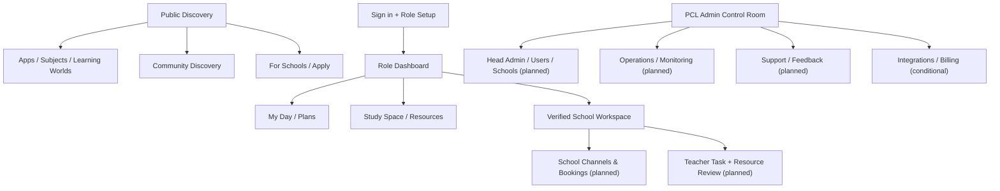

# StudyBuddy UI architecture — screen-by-screen component placement

**18 November 2026 · Product-facing blueprint.** A slash path marked **CURRENT** is evidenced by the uploaded source/terminal log; **PROPOSED** paths are design contracts and must not be linked from live navigation until built. All React Bits Pro items below are **reference selections**, not installed paid source. Prefer real properly licensed *free* React Bits / ReactDrops code for eligible effects when technically appropriate, and independent originals for Pro app patterns.

## Experience sitemap

## Public and learner-facing screens

| Screen and role | Main structure in reading order | Specific selected components | Data integration / permission | Motion budget and mobile rule |
|---|---|---|---|---|
| `/` Home (CURRENT) | One clear hero → genuine featured games → subject exploration → how it works | Galaxy or GradientWaves **one background**, FlexCarousel/CardSwap, Chromatic Button, optional Liquid Glass Logo | CMS-published games only | Hero animation below content; static art on low-power device |
| `/apps` (CURRENT) | Search → subject facets → playable game cards → truthful empty state | Filtering 1, Arc List, CircularGallery or Fan Gallery (choose **one**), optional WebThreads | Real catalog, approved subject taxonomy | Accessible filters; do not load gallery WebGL for every item |
| `/apps/{slug}` / `/play/{slug}` (CURRENT) | App overview, compatibility, safe launch, genuine progress where instrumented | Device preview, optional MorphSlider, SpringCheck after actual completion | Current app record / authenticated reward rules | Gameplay has priority over animation and ads |
| `/roles` (CURRENT) | Student/parent/teacher/independent role descriptions and real permissions | MagicBento, Fan Gallery/DepthCarousel as one feature group | Public role definitions, no privileged data | Touch cards, simple semantic headings |
| `/for-schools` / `/schools/apply` (CURRENT) | School value, safeguarding summary, application | Forms 2 (if useful), Wizard 4 then 5 only after real flow | Application and human school verification | Professional restrained layout |
| `/community` (CURRENT discovery; messages PLANNED) | Search/filter public profiles → safe community areas → report/help | Chat 2, Chat 5, Comments 4 for approved modules; AnimationList sparingly | Consent, role allowlists, approved membership, blocked users | No global stranger inbox or searchable child index |
| `/getting-started` (CURRENT P08) | Full-width setup → role-safe steps → review → save feedback | Wizard 2, Onboarding 1–7, Wizard 4/5/6 where actual tasks exist | `StudyBuddyOnboardingController`, saved user profile | Simple progress indicator; sticky Next/Back mobile |
| `/dashboard` student (CURRENT P07) | One adaptive command hero → task queue → recommended real apps → private progress | Dashboard 3, Simple Graph, Analytics 5 only if real category data, Scroll Stack | Auth user + real assignments; never public cohort data | No second hero; no giant analytics if empty |
| `/dashboard` independent learner (CURRENT P07) | Goal → My Day → personal library → selected games | Dashboard 3, animated card patterns, SpringCheck | Only own records | 1-column small view and no artificial streaks |
| `/dashboard` parent (CURRENT P07) | Approved child connections → authorized progress → meetings/messages when ready | Analytics 5, Simple Graph, Notifications 6 | Guardian approval, not email-based assumptions | Summary-first, limit private detail exposure |
| `/dashboard` teacher (CURRENT P07) | Class actions → verified roster → assigned work → relevant trends | Dashboard 11 (later), Analytics 5/9, Data Table 6, Scheduling 4 | Verified classes and active roles | Compact action area; forms and roster stay functional |
| `/my-day` (CURRENT P09) | Calendar, saved plans, real assignments, account-only weekly activity | Scheduling 1/3/4/7 (future booked meetings), Notifications 3/6 | P09 actual plan store, verified assignment deadlines | Week/day toggle on phone, honest no-availability state |
| `/study-space` (CURRENT P06) | Session conversation UI → private tools → resources → microphone if approved | App Shell 9, AI Chat 8, Waveform Player, optional Liquid Glass Orb | Session shell not AI; no transcript/provider until configured | No microphone auto-start; transcript review before sending |
| `/resources` (CURRENT P10) | Private files / notes → editor → safe preview → sharing only after approval | File Manager 1–4, Editor 2/5, Waveform Player; Comments 2/6 (P15) | Owner authorization and private storage; P15 separate sharing | Accessible file list on mobile, preview modal safe |
| `/profile/edit` (CURRENT) | Account profile, privacy settings, appearance and personal preferences | Settings Form 1, Onboarding 1 original P08 | Current authenticated profile write action | Sticky Save/Discard only when dirty; no lost edits |
| `/help` / `/feedback` (PROPOSED) | Search help → suggested articles → ticket/feedback composer | Support 1/2; Feedback 1/2/3, Forms 10 | Own ticket, consented screenshot, CSRF/rate limits | Bottom sheet or full page on mobile |

## School OS screens

| Screen / module | Primary component(s) | Backing workflow | Critical limit |
|---|---|---|---|
| `/schools/{organization}/workspace` (CURRENT shell) | App Sidebar 4 contextual rail, Dashboard 11 staffing board, Analytics 5 donut | Verified membership, actionable school summary | Don't mix another school's records |
| Organization staff & classes (PROPOSED expansion) | Data Table 6, Forms 2, Kanban 2 | Staff invites, teacher/class assignments, active member checks | Institution admin ≠ platform admin |
| Staff/class channel (PROPOSED) | Chat 5 + attachments, Chat 2 for permitted staff DMs, Comments 4 mentions | Member-scoped channels + reports + receipts | No unapproved adult–minor DMs; disclosed oversight |
| School resources & lesson reviews (PROPOSED) | File Manager 2/3, Editor 2/4/5, Comments 2 & 6 | Document version anchors, suggestions, moderation | New sharing permissions, cannot repurpose private P10 files silently |
| School team taskboard (PROPOSED) | Kanban 2 swimlanes + Kanban 4 detail panel | Saved status/assignee changes + audit | No tracking of students as "staffing utilization" |
| Calendar & parent–teacher booking (PROPOSED) | Scheduling 3, 4, 7 | Attendee check, timezone-safe conflict/reservation transactions | No invented open slots |
| School settings & subscription (settings PROPOSED; billing HOLD) | Settings Form 1, Wizard 2/5, Billing 1/2/5 | Own org preferences, approved invoices/entitlements | No fake/prerecorded invoices |

## PCL Control Room screens

| Screen / module | Primary component(s) | Real action and data contract | Access |
|---|---|---|---|
| `/admin/control-room` (CURRENT shell) | App Sidebar 4 rail + secondary panel; Dashboard 3 overview, Analytics 5, List 3 compact feed | Actual site counts and recent permitted actions; no duplicative header stacks | Scoped admin, with root-only controls hidden AND denied server-side |
| Head Admin / team roles (PROPOSED) | Data Table 6, Forms 2, Wizard 2/5/6 | Create PCL staff principals, granular roles, step-up confirmation, audit | Head only for grants, cannot demote/delete Head |
| Schools review (CURRENT route + PROPOSED UX) | Data Table 6 + detail panel, Wizard 5 approval | School application verification and school-safe audit | `schools.review` permission only |
| Users / test accounts (PROPOSED UX) | Data Table 6, Forms 2 | Provision supervised role-aware test users; separate real data | No automatic privileged test users |
| Content & app CMS (CURRENT) | File Manager 1/2/4, Editor 2/4/5, Settings Form 1 | CMS write actions with preview/publish audit | Only approved content permissions |
| Support & feedback (PROPOSED) | Support 1/2; Feedback 5/6; List 11 | Tickets/ratings, privacy-safe assignment and evidence-based performance | Support staff; redact child data |
| Security center (PROPOSED full dashboard) | List 3 security event feed, Monitoring 5 filtered logs | Actual stored audit events and redacted logs | Security-read scope only |
| Platform health & queues (PROPOSED) | Monitoring 6 daily uptime, 7 service utilization, 8 request latency, 9 job queue | Only measured probes, service counters, real job states | Ops read/write separated |
| Analytics workspace (PROPOSED) | Analytics 5 donut, Analytics 9 heatmap, Analytics 11 cohort matrix, Simple/Particle Graph | Consent-appropriate activity aggregates | No public individual learner heatmaps |
| Workflows / tasks (PROPOSED) | Kanban 2/4, Comments 4, Editor 4 | Team workboard, suggestions and status audit | Actor-scoped updates |
| Integrations (CONDITIONAL) | Integrations 1–5 | Marketplace, actual connection scopes, hashed keys, signed deliveries, real OAuth | Security/admin with step-up auth |
| Billing (CONDITIONAL) | Billing 1/2/4/5, Wizard 3, Paywall 4/5 | Real paid plans, invoices, renewal/payment recovery | Approved gateway, finance role, no minors charges |

## Sidebar decision — avoid two sidebars

**Desktop staff/admin:** App Sidebar 4 pattern is primary: 64–72px icon rail → 220–260px contextual panel → content, with collapsible state. App Sidebar 2 flyouts are for **quick tooltips/flyouts**, not a second competing navigation. Text labels and keyboard focus are mandatory. Mobile: header + one accessible menu sheet, no permanent multi-rail layout.

**Learner/parent:** keep current top navigation and role dashboard shortcuts, optionally a simplified icon dock only when it improves use. Do not force staff navigation onto children.

## Practical design-token principles

- **Shared palette:** deep navy/graphite foundations, indigo/violet, cyan focus, clean high-contrast text, limited glass/blur. Reuse actual existing tokens from CSS; token names must be verified in source before code edits.
- **Image placement:** P07 banners go on role/page heroes, subject icons on matching subject cards. The 44 archived images are a curated asset bank, not background wallpaper everywhere. Read `public/assets/studybuddy-p07/ASSETS_MANIFEST.json` before selecting an archive image.
- **Animation budget:** one decorative ambient effect on marketing surfaces, near zero on tables/forms or safety pages; respect `prefers-reduced-motion`; no mandatory cursor changes on touch.
- **Interaction budget:** maximum one prominent primary CTA per panel, one save path per settings form, one main sidebar per page, one data source per metric. All effects provide non-animated, accessible alternatives.
- **Resource constraints:** lazy-load code/data per route; avoid bundling the full React Bits wishlist into every Laravel Blade page.
